# 🛡️ Seguridad AAA — RADIUS (NPS) y Active Directory en Router y Switch Cisco

**Albert Euclides Garcia — Matrícula 2025-2241 (`20252241`)**


-5C2D91?style=for-the-badge)


> Un servidor Windows con **Active Directory** y **NPS** centraliza la autenticación, la autorización y el registro de acceso a un router y a un switch Cisco. Tres grupos de AD (nivel 0, 5 y 10) determinan el privilegio que recibe cada administrador. La consola y el puerto auxiliar se validan contra RADIUS, y el SSH usa un usuario local.

* * *

## 📺 Video de Demostración

> [**Ver demostración en YouTube →**](PEGAR_ENLACE_YOUTUBE_AQUI)

* * *

## 📑 Tabla de Contenido

1. [Propósito del Laboratorio](#-propósito-del-laboratorio)
2. [Cumplimiento de Requisitos](#-cumplimiento-de-requisitos)
3. [Direccionamiento IP basado en la matrícula](#-direccionamiento-ip-basado-en-la-matrícula)
4. [Parámetros Usados](#-parámetros-usados)
5. [Documentación de la Red](#-documentación-de-la-red)
6. [Funcionamiento de la Configuración](#-funcionamiento-de-la-configuración)
7. [Validación de la Implementación](#-validación-de-la-implementación)
8. [Scripts](#-scripts)
9. [Estructura del Repositorio](#-estructura-del-repositorio)

* * *

## 🎯 Propósito del Laboratorio

Demostrar el acceso administrativo seguro a equipos de red mediante **AAA** (autenticación, autorización y contabilidad), aplicando estas políticas:

- La **autenticación** de la consola y del puerto auxiliar del router y del switch se valida contra un servidor **RADIUS (NPS)** integrado con Active Directory, con un usuario local como respaldo.
- La **autorización** se define por grupo de AD: el nivel 0, el nivel 5 y el nivel 10 reciben privilegios distintos en el equipo, siguiendo el principio de **mínimo privilegio**.
- Los accesos correctos y fallidos, los cambios de privilegio y la contabilidad RADIUS quedan **registrados** en los equipos y en el servidor.
- La administración remota se hace por **SSH** con un usuario local.
- AAA por RADIUS se aplica **solo a los puertos de consola y auxiliar**.

* * *

## ✅ Cumplimiento de Requisitos

| Requisito | Implementado con |
|---|---|
| Seguridad en todos los niveles de autenticación y autorización (router y switch) | `aaa new-model` con listas de autenticación, autorización y contabilidad, privilegios 0, 5, 10 y 15 y `aaa authorization console` |
| RADIUS como cliente | `radius server NPS-2241` (`10.22.41.10`, autenticación 1812 y contabilidad 1813) y grupo `GRP-NPS`, en R1 y SW1. Ambos están registrados en NPS como clientes RADIUS |
| Usuario local | `admin-local` con privilegio 15 en cada equipo, y respaldo local en las listas de AAA |
| AAA solo en consola y auxiliar | Listas `CON-AUX-AUTH`, `CON-AUX-AUTHZ` y `CON-AUX-ACCT` aplicadas únicamente a `line con 0` y `line aux 0`. Las líneas vty usan la lista por defecto (local) |
| Logs de autenticación, autorización y RADIUS | `login on-success log`, `login on-failure log`, `logging userinfo`, `logging buffered`, contabilidad `exec` y `system` hacia RADIUS, y eventos 6272 y 6273 en NPS |
| Servicio SSH | SSH versión 2, claves RSA de 2048 bits y `transport input ssh` en las líneas vty |
| Active Directory con un grupo de nivel 0, 5 y 10 | `GRP-Nivel0`, `GRP-Nivel5` y `GRP-Nivel10` en la OU `AAA-2241` del dominio `aaa2241.local`, con un usuario por grupo |
| Servicio NPS | Rol NPS con tres directivas de red (`Nivel0-Cisco`, `Nivel5-Cisco` y `Nivel10-Cisco`) que devuelven el privilegio en el atributo `Cisco-AV-Pair` |
| Direccionamiento basado en la matrícula | Red `10.22.41.0/24`, derivada de los dígitos `22` y `41` de la matrícula |
| Repositorio con video, documentación, diagramas, imágenes, scripts y running-configs | Este repositorio |

* * *

## 🧮 Direccionamiento IP basado en la matrícula

### 1. Origen de las direcciones

Mi matrícula es **2025-2241** (`20252241`). Tomé sus últimos cuatro dígitos, `2241`, separados en dos pares, **`22`** y **`41`**:

| Dígitos de la matrícula | Dónde se usan | Ejemplo |
|---|---|---|
| `22` → segundo octeto | Red privada de la infraestructura | 10.**22**.41.0 |
| `41` → tercer octeto | Red privada de la infraestructura | 10.22.**41**.0 |

### 2. Red utilizada

Una sola red de administración con tres equipos, así que un prefijo /24 es suficiente:

| Segmento | Prefijo | Máscara | Hosts útiles | Red | Rango utilizable | Broadcast |
|---|---|---|---|---|---|---|
| Administración | /24 | 255.255.255.0 | 254 | 10.22.41.0 | 10.22.41.1 – 10.22.41.254 | 10.22.41.255 |

**Cálculo del prefijo:** 32 − 24 = 8 bits de host → 2⁸ = 256 direcciones → 254 hosts útiles.

### 3. Asignación de direcciones

| Dispositivo | Interfaz | IP | Subred |
|---|---|---|---|
| R1-2241 | FastEthernet0/0 | 10.22.41.1 | 10.22.41.0/24 |
| SW1-2241 | VLAN 1 (SVI) | 10.22.41.2 | 10.22.41.0/24 |
| NPS-2241 (servidor) | Ethernet1 (VMnet2) | 10.22.41.10 | 10.22.41.0/24 |

**Evidencia:**

Adaptadores de red de la máquina virtual del servidor (NAT para internet y VMnet2 para la topología):

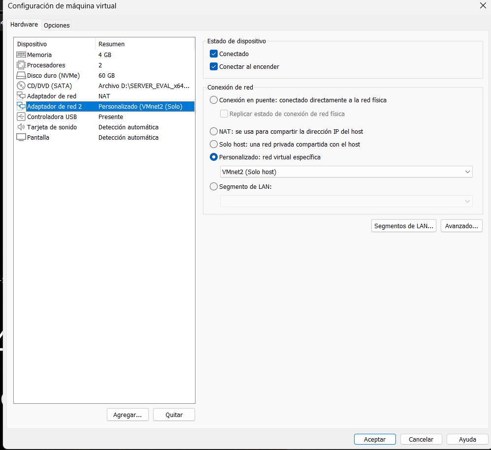

Conectividad del servidor hacia el router y el switch:

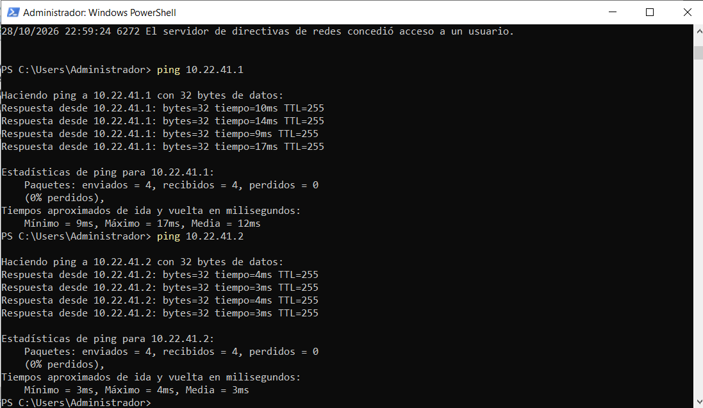

* * *

## 🧩 Parámetros Usados

| Parámetro | Valor |
|---|---|
| Router | Cisco 7200 (`R1-2241`), IOS 15.2(4)S6, imagen `c7200-adventerprisek9` |
| Switch | Cisco IOSvL2 (`SW1-2241`), plantilla QEMU de GNS3 |
| Servidor | Windows Server 2022 Standard Evaluation en VMware Workstation. Máquina virtual `NPS-2241`, nombre de equipo `WIN-7OP9FHTIEQO` |
| Emulador | GNS3 con GNS3 VM sobre VMware Workstation |
| Enlace servidor ↔ topología | Nodo Cloud `cloud-nps` con la red virtual `VMnet2` |
| Dominio de Active Directory | `aaa2241.local` (NetBIOS `AAA2241`) |
| Unidad organizativa | `AAA-2241` |
| Grupos y usuarios | `GRP-Nivel0` → `user-nivel0`, `GRP-Nivel5` → `user-nivel5`, `GRP-Nivel10` → `user-nivel10` |
| RADIUS | Autenticación UDP 1812, contabilidad UDP 1813, método de autenticación PAP |
| Atributo de autorización | `Cisco-AV-Pair` = `shell:priv-lvl=<nivel>`, con tipo de servicio Inicio de sesión (Login) |
| Listas AAA | `CON-AUX-AUTH`, `CON-AUX-AUTHZ`, `CON-AUX-ACCT` (consola y auxiliar) y las listas por defecto (vty) |
| SSH | Versión 2, claves RSA de 2048 bits, tiempo de espera 60 s y 3 reintentos |
| Niveles de privilegio | 0, 5 y 10 (por RADIUS) y 15 (usuario local `admin-local`) |

* * *

## 📡 Documentación de la Red

### Topología

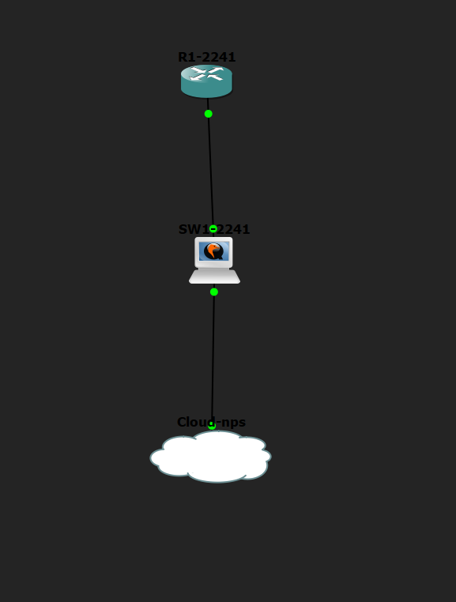

### Diagrama lógico

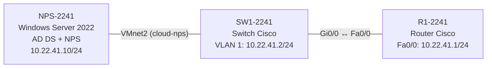

| Origen | Destino |
|---|---|
| `SW1-2241` GigabitEthernet0/0 | `R1-2241` FastEthernet0/0 |
| `SW1-2241` GigabitEthernet0/1 | `cloud-nps` (VMnet2) |

### Diagrama de autenticación y autorización

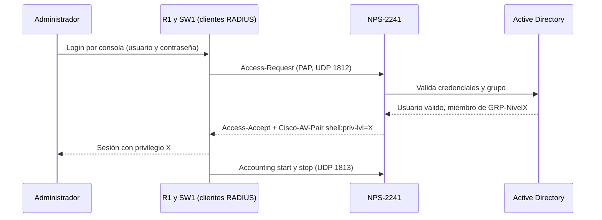

### Diagrama de acceso (qué puede hacer cada nivel)

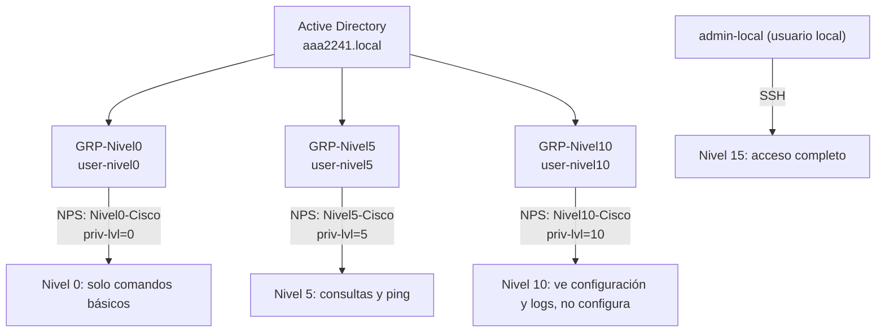

### Active Directory

Dominio `aaa2241.local`:

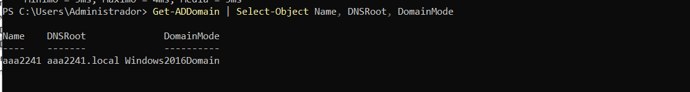

Grupos de nivel 0, 5 y 10 con sus miembros:

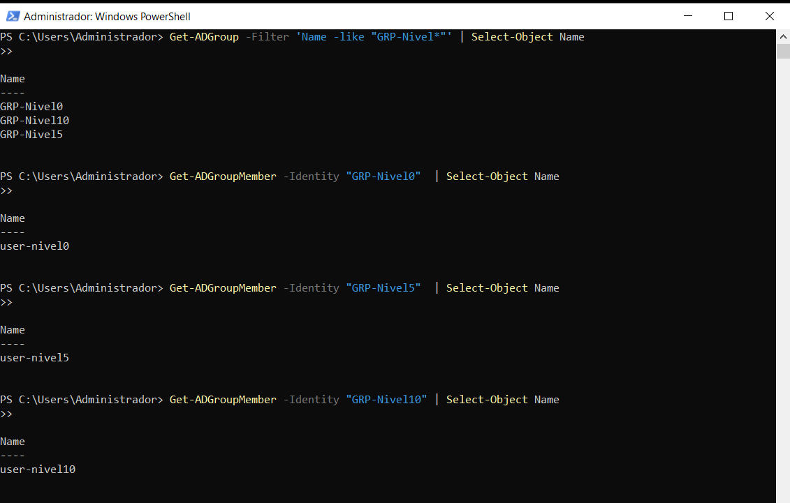

Unidad organizativa `AAA-2241` con los grupos y los usuarios:

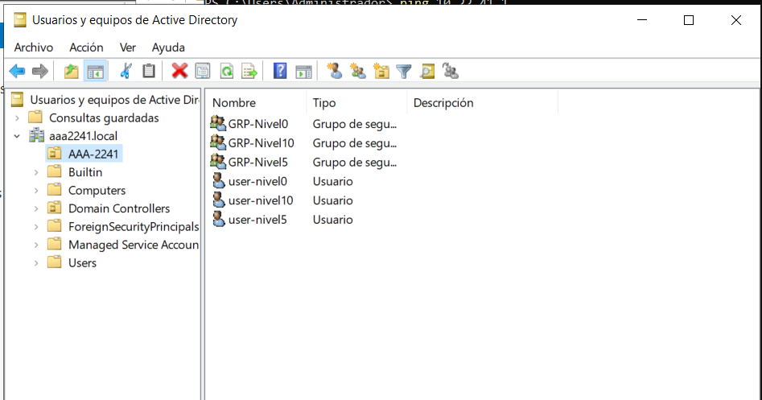

### NPS (servidor RADIUS)

Clientes RADIUS (el router y el switch):

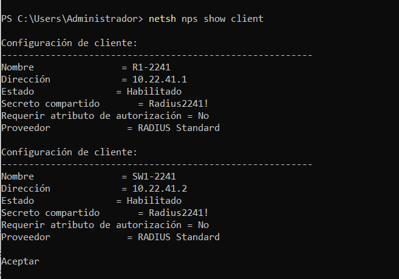

Directivas de red en orden. Las dos directivas por defecto están deshabilitadas:

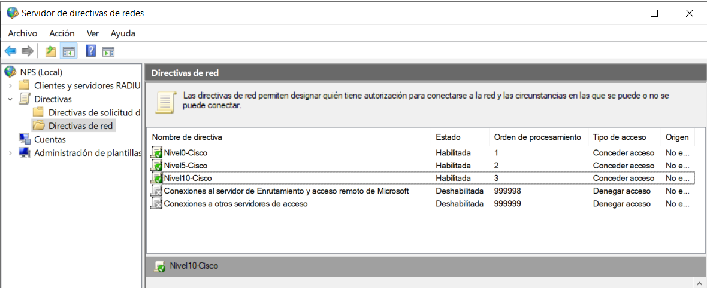

**Nivel 0** — `Nivel0-Cisco`, atributo `shell:priv-lvl=0`:

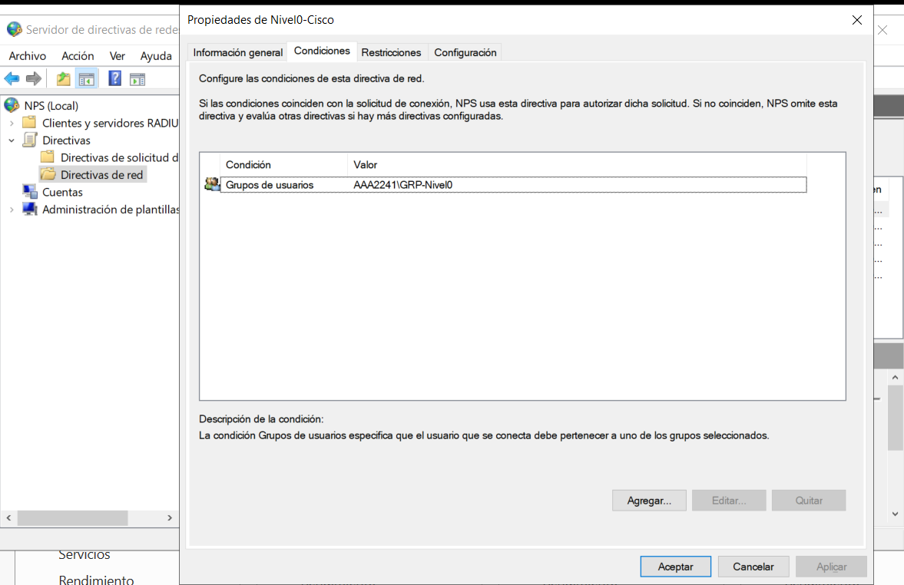

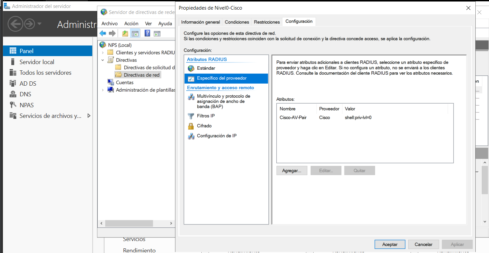

**Nivel 5** — `Nivel5-Cisco`, atributo `shell:priv-lvl=5`:

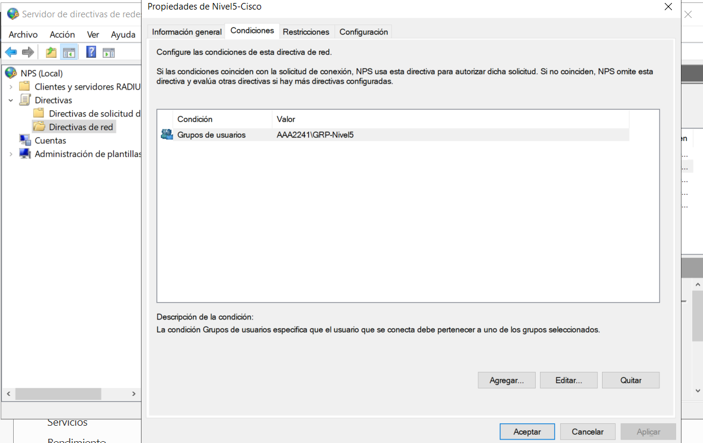

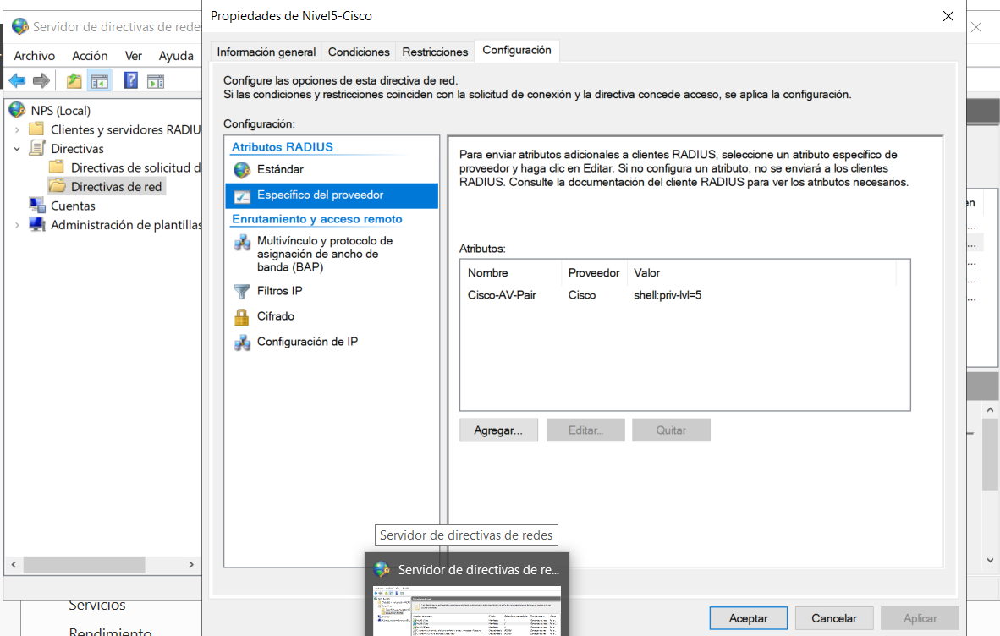

**Nivel 10** — `Nivel10-Cisco`, atributo `shell:priv-lvl=10`:

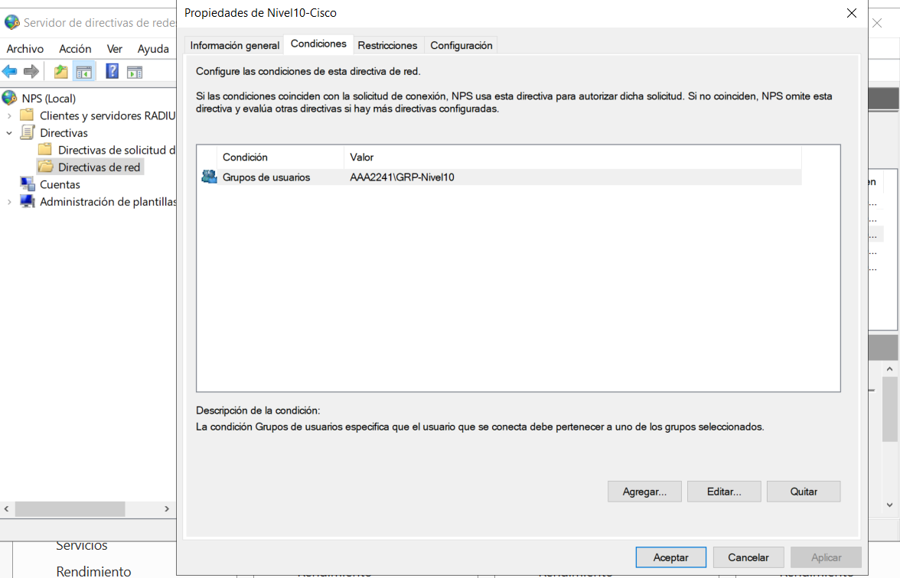

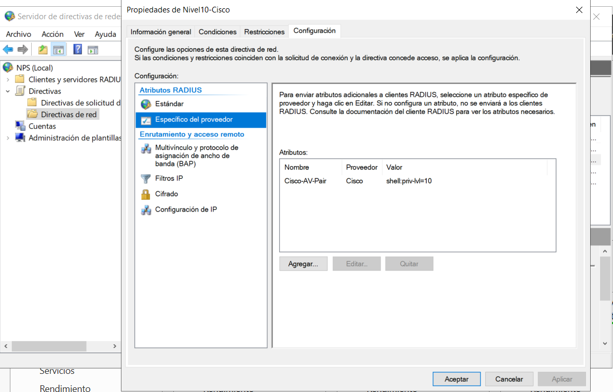

### Router y switch

Configuración de AAA y SSH verificada en `R1-2241`:

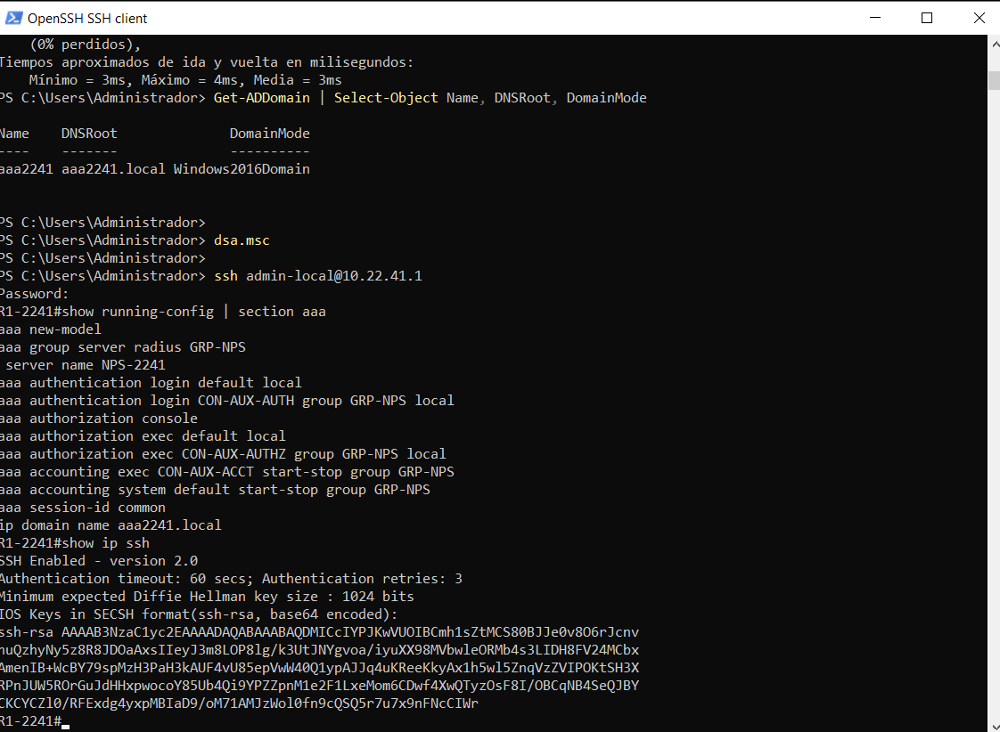

Configuración de AAA y SSH verificada en `SW1-2241`:

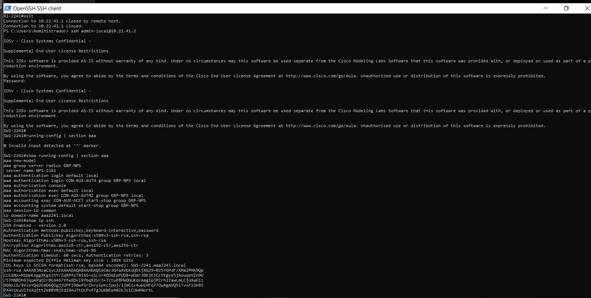

* * *

## 🔬 Funcionamiento de la Configuración

**Autenticación:** al entrar por la consola o el puerto auxiliar, el equipo pide usuario y contraseña y los envía al servidor NPS (`10.22.41.10`) por RADIUS. NPS los valida contra Active Directory. Si NPS no responde, el equipo usa el usuario local como respaldo. Por SSH, las líneas vty usan la lista por defecto, que valida contra el usuario local `admin-local`.

**Autorización:** NPS comprueba a qué grupo de AD pertenece el usuario y aplica la directiva de red que corresponde. Esa directiva responde con el atributo `Cisco-AV-Pair` (`shell:priv-lvl=0`, `5` o `10`), y el equipo le asigna ese nivel de privilegio. El comando `aaa authorization console` es necesario para que el nivel se aplique en la consola.

**Contabilidad y logs:** cada sesión de `exec` genera un registro de inicio y de cierre hacia NPS, y los eventos del sistema también se contabilizan. En el equipo quedan los eventos de acceso correcto y fallido, y los cambios de privilegio. En el servidor, NPS registra los accesos concedidos (evento 6272) y los denegados (evento 6273).

**Listas de AAA** (en R1 y SW1):

| Lista | Tipo | Método | Aplicada en |
|---|---|---|---|
| `CON-AUX-AUTH` | Autenticación de login | `group GRP-NPS local` | `line con 0` y `line aux 0` |
| `CON-AUX-AUTHZ` | Autorización de `exec` | `group GRP-NPS local` | `line con 0` y `line aux 0` |
| `CON-AUX-ACCT` | Contabilidad de `exec` | `start-stop group GRP-NPS` | `line con 0` y `line aux 0` |
| `default` | Autenticación de login y autorización de `exec` | `local` | Líneas vty (SSH) |
| `default` | Contabilidad de `system` | `start-stop group GRP-NPS` | Global |

**Directivas de red en NPS:**

| Directiva | Condición | Autenticación | Atributo devuelto |
|---|---|---|---|
| `Nivel0-Cisco` | Grupo `GRP-Nivel0` | PAP | `Cisco-AV-Pair` = `shell:priv-lvl=0` |
| `Nivel5-Cisco` | Grupo `GRP-Nivel5` | PAP | `Cisco-AV-Pair` = `shell:priv-lvl=5` |
| `Nivel10-Cisco` | Grupo `GRP-Nivel10` | PAP | `Cisco-AV-Pair` = `shell:priv-lvl=10` |

**Niveles de acceso:**

| Grupo de AD | Usuario | Privilegio | Qué puede hacer |
|---|---|---|---|
| `GRP-Nivel0` | `user-nivel0` | 0 | Solo `disable`, `enable`, `exit`, `help` y `logout` |
| `GRP-Nivel5` | `user-nivel5` | 5 | Consultas básicas (`show privilege`, `show ip interface brief`) y `ping` |
| `GRP-Nivel10` | `user-nivel10` | 10 | Lo anterior, más `show running-config` y `show logging`. No puede entrar al modo de configuración |
| (local) | `admin-local` | 15 | Acceso completo por SSH |

**Notas:**

- **SSH y cifrados:** la imagen de IOS usada (15.2) solo ofrece cifrados CBC en SSH, que el cliente SSH de Windows tiene desactivados por defecto. Se agregó una configuración de cliente (`~/.ssh/config`) para estos equipos. Está en [`06-pruebas-y-ssh.ps1`](scripts/06.ps1).
- **Auxiliar:** la configuración de `line aux 0` se aplicó en los equipos cuya imagen incluye puerto auxiliar (ver las running-configs).
- **Visibilidad de la configuración:** en niveles menores a 15, `show running-config` muestra solo las partes de la configuración que ese nivel puede ver.
- **Mejora futura:** el comando `enable` con la contraseña de `enable secret` permite subir a nivel 15 desde cualquier usuario. Una mejora sería autenticar también `enable` contra el servidor de autenticación.

* * *

## ✅ Validación de la Implementación

### Router `R1-2241`

**Prueba 1 — Nivel 0:** el usuario `user-nivel0` entra por la consola y solo dispone de los comandos básicos.

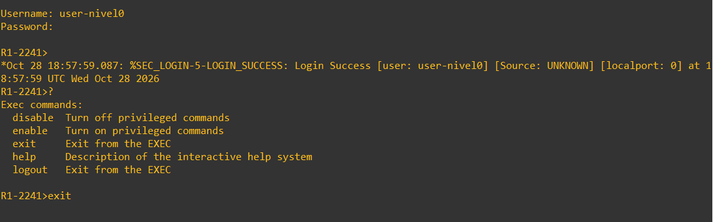

**Prueba 2 — Nivel 5:** `user-nivel5` tiene privilegio 5, consulta las interfaces, pero `show running-config` es rechazado.

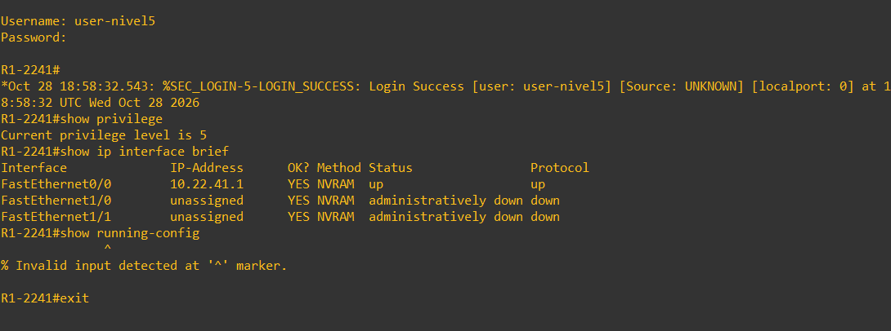

**Prueba 3 — Nivel 10:** `user-nivel10` tiene privilegio 10 y ve la configuración, pero `configure terminal` es rechazado.

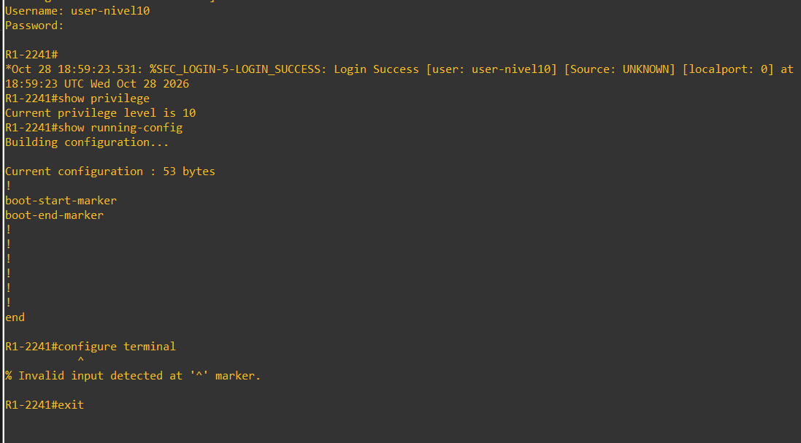

**Prueba 4 — Login fallido:** con una contraseña incorrecta, RADIUS rechaza el acceso y el router no abre la sesión.

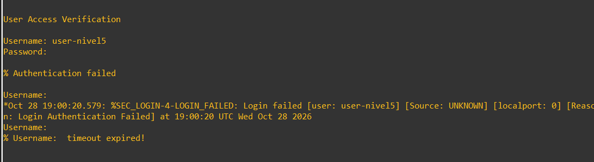

**Prueba 5 — SSH con el usuario local:** `admin-local` entra por SSH con privilegio 15.

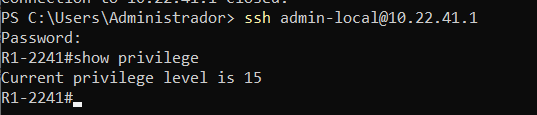

**Prueba 6 — Estado de RADIUS y logs:** `show aaa servers` muestra los contadores de autenticación y contabilidad, y `show logging` muestra los accesos correctos, el intento fallido y los cambios de privilegio.

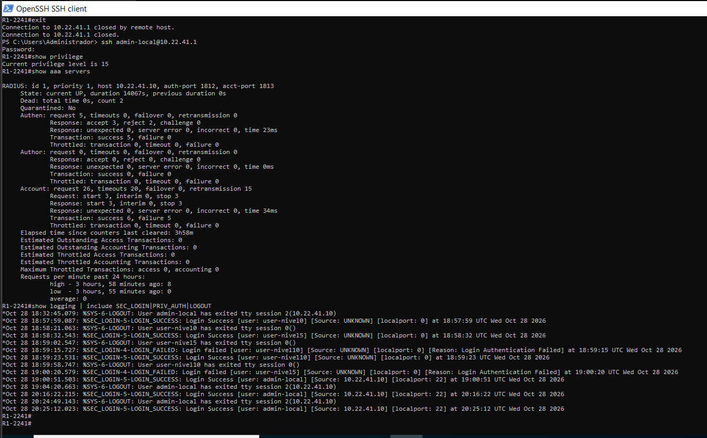

### Switch `SW1-2241`

**Prueba 7 — Nivel 0:**

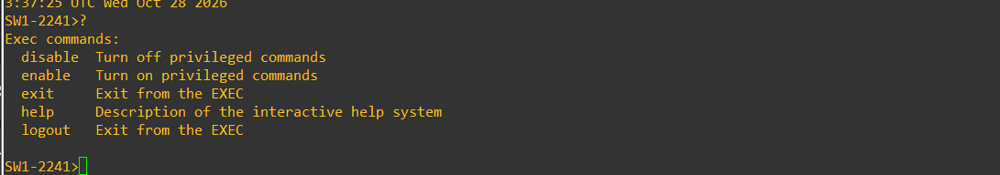

**Prueba 8 — Nivel 5:**

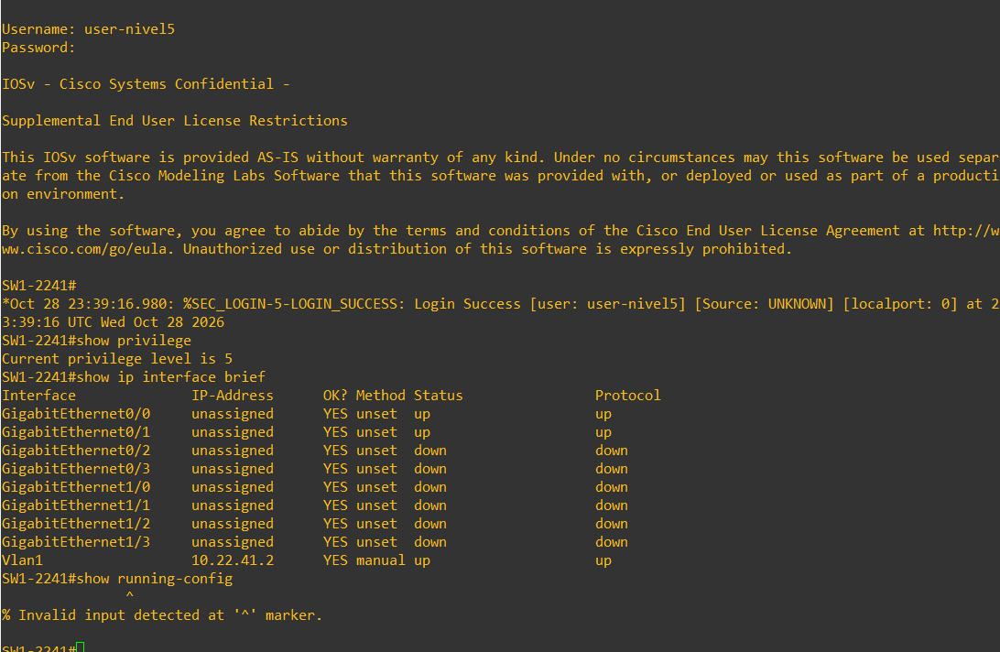

**Prueba 9 — Nivel 10:**

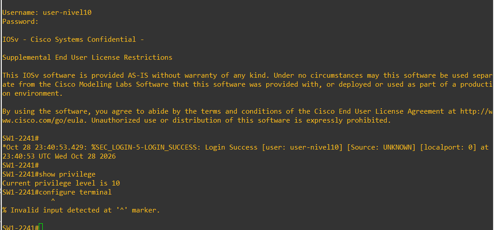

**Prueba 10 — Login fallido:**

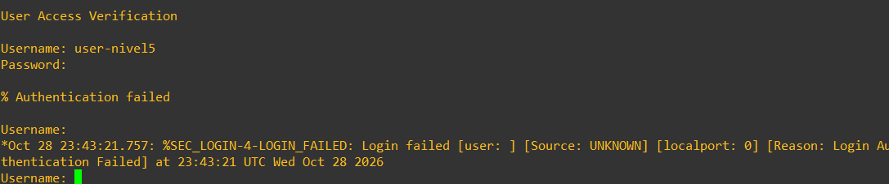

**Prueba 11 — SSH con el usuario local:**

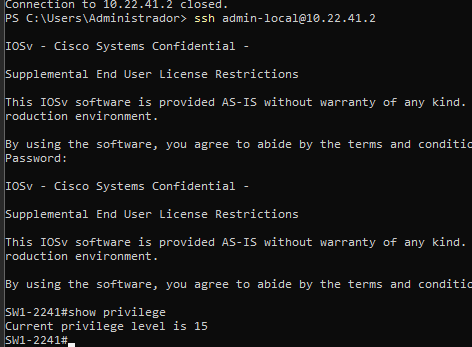

**Prueba 12 — Estado de RADIUS y logs:**

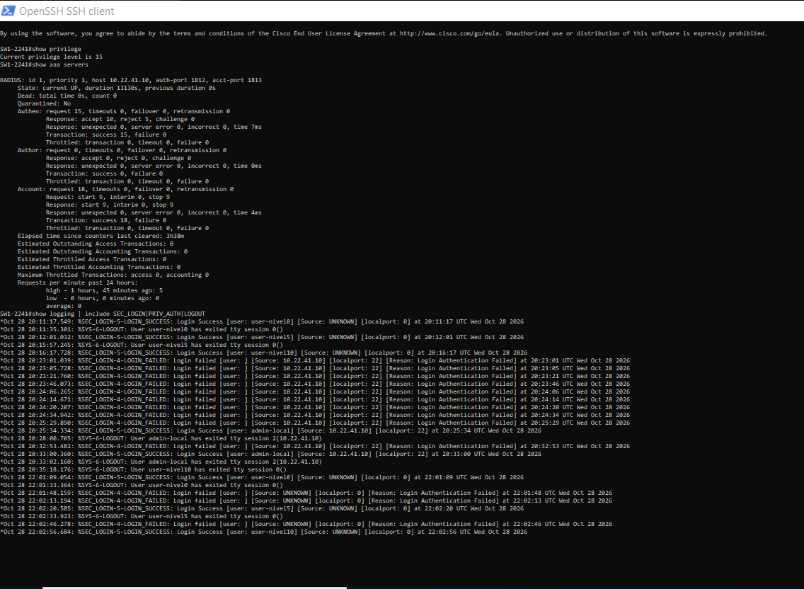

### Servidor NPS

**Prueba 13 — Registro en el servidor:** los eventos 6272 son accesos concedidos y los 6273 son accesos denegados, incluidos los intentos con contraseña incorrecta.

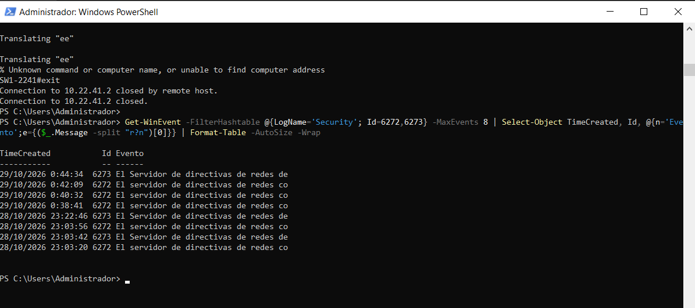

* * *

## 📜 Scripts

### Scripts de configuración

Los equipos de red se configuraron por consola con los comandos de abajo. Las configuraciones finales completas están en `running-configs/`.

**R1-2241** (router)

```
enable
configure terminal
username admin-local privilege 15 secret <contraseña>
enable secret <contraseña>
service password-encryption
ip domain-name aaa2241.local
crypto key generate rsa modulus 2048
ip ssh version 2
ip ssh time-out 60
ip ssh authentication-retries 3
!
aaa new-model
radius server NPS-2241
 address ipv4 10.22.41.10 auth-port 1812 acct-port 1813
 key <secreto-radius>
 exit
aaa group server radius GRP-NPS
 server name NPS-2241
 exit
aaa authentication login CON-AUX-AUTH group GRP-NPS local
aaa authorization console
aaa authorization exec CON-AUX-AUTHZ group GRP-NPS local
aaa accounting exec CON-AUX-ACCT start-stop group GRP-NPS
aaa accounting system default start-stop group GRP-NPS
aaa authentication login default local
aaa authorization exec default local
!
line con 0
 login authentication CON-AUX-AUTH
 authorization exec CON-AUX-AUTHZ
 accounting exec CON-AUX-ACCT
 logging synchronous
 exec-timeout 10 0
 exit
line aux 0
 login authentication CON-AUX-AUTH
 authorization exec CON-AUX-AUTHZ
 accounting exec CON-AUX-ACCT
 exec-timeout 10 0
 exit
line vty 0 4
 transport input ssh
 exec-timeout 10 0
 length 0
 exit
!
service timestamps log datetime msec
service timestamps debug datetime msec
logging on
logging buffered 64000 informational
logging userinfo
login on-success log
login on-failure log
!
privilege exec level 10 show running-config
privilege exec level 10 show logging
privilege exec level 5 show ip interface brief
privilege exec level 5 ping
privilege exec level 5 show
end
write memory
```

**SW1-2241** (switch)

La configuración de seguridad es la misma que la del router. Las diferencias son:

```
! Conectividad base
hostname SW1-2241
interface GigabitEthernet0/0
 description UPLINK-R1
 no shutdown
interface GigabitEthernet0/1
 description SERVIDOR-NPS
 no shutdown
interface vlan 1
 ip address 10.22.41.2 255.255.255.0
 no shutdown
ip default-gateway 10.22.41.1
!
! Líneas vty (el switch tiene 16)
line vty 0 15
 transport input ssh
 exec-timeout 10 0
 length 0
```

> Las contraseñas, claves y hashes no se incluyen en este repositorio.

### Scripts de la práctica

La carpeta [`scripts/`](scripts/) contiene los comandos completos usados en cada fase, en el orden en que se ejecutaron:

| Script | Dónde se ejecuta | Qué contiene |
|---|---|---|
| [`01-conectividad.txt`](scripts/01-conectividad.txt) | PowerShell del servidor y consolas de R1 y SW1 | Direccionamiento IP, configuración base de R1 y SW1, y pruebas de ping |
| [`02-active-directory.ps1`](scripts/02-active-directory.ps1) | PowerShell del servidor | Instalación de AD DS, creación del dominio `aaa2241.local`, la OU, los tres grupos y los tres usuarios, y su verificación |
| [`03-nps.ps1`](scripts/03-nps.ps1) | PowerShell del servidor y consola `nps.msc` | Instalación del rol NPS, clientes RADIUS, guía de las tres directivas de red, auditoría y exportación |
| [`04-R1-2241-aaa.txt`](scripts/04-R1-2241-aaa.txt) | Consola de R1 | Usuario local, SSH, AAA con RADIUS, líneas, logs y niveles de privilegio del router |
| [`05-SW1-2241-aaa.txt`](scripts/05-SW1-2241-aaa.txt) | Consola de SW1 | La misma configuración de seguridad aplicada al switch |
| [`06-pruebas-y-ssh.ps1`](scripts/06-pruebas-y-ssh.ps1) | PowerShell del servidor | Configuración del cliente SSH, pruebas de acceso, consulta de eventos de NPS y exportación de configuraciones |

* * *

## 📁 Estructura del Repositorio

```
README.md
image/
├── 01-topologia.png
├── 02-adaptadores-vmware.png
├── 03-ping-conectividad.png
├── 04-dominio-ad.png
├── 05-grupos-miembros.png
├── 06-ou-aaa-2241.png
├── 07-clientes-radius.png
├── 08-directivas-nps.png
├── 09-nivel0-condiciones.png
├── 10-nivel0-configuracion.png
├── 11-nivel5-condiciones.png
├── 12-nivel5-configuracion.png
├── 13-nivel10-condiciones.png
├── 14-nivel10-configuracion.png
├── 15-r1-config-aaa-ssh.png
├── 16-r1-nivel0.png
├── 17-r1-nivel5.png
├── 18-r1-nivel10.png
├── 19-r1-login-fallido.png
├── 20-r1-ssh-local.png
├── 21-r1-radius-logs.png
├── 22-sw1-config-aaa-ssh.png
├── 23-sw1-nivel0.png
├── 24-sw1-nivel5.png
├── 25-sw1-nivel10.png
├── 26-sw1-login-fallido.png
├── 27-sw1-ssh-local.png
├── 28-sw1-radius-logs.png
└── 29-eventos-nps.png

running-configs/
├── R1-2241-running-config.txt
├── SW1-2241-running-config.txt
└── NPS-2241-config.xml

scripts/
├── 01-conectividad.txt
├── 02-active-directory.ps1
├── 03-nps.ps1
├── 04-R1-2241-aaa.txt
├── 05-SW1-2241-aaa.txt
└── 06-pruebas-y-ssh.ps1
```
